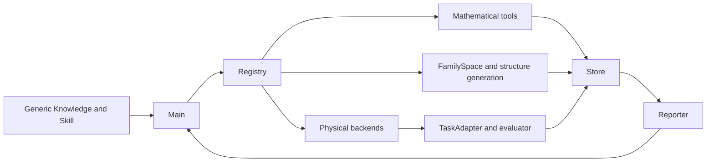

# Architecture

**Main** is the existing Strands-based research decision maker. It selects registered actions, candidates, methods and interpretations. **Reporter** reads existing results and returns source-bound scientific interpretations; it does not replace numerical tools or the independent task evaluator.

**Registry and Host** validate typed requests, resolve only trusted registered implementations and account for operations. **Store** is the production SQLite ledger and immutable blob implementation. The package contains this implementation, not research databases. Its authority anchor and every default run directory are below `SOFTROBOT_AGENT_HOME`.

**TaskAdapter and evaluator** preserve the task definition, observable meanings and acceptance semantics. Mathematical results, task acceptance and completion of a model call remain distinct. This migration adds no new agent, optimizer, task family or acceptance semantics.

**FamilySpace and structure generation** expose bounded design domains, generate candidate-owned structures and compile physical models. Generic mathematical modules provide local mechanics, sensitivity, controllability, constrained optimization and registered search. Optional MuJoCo and MATLAB/SoRoSim adapters execute the corresponding physical/model operations; CasADi and conic solvers provide optional numerical methods.

**Knowledge and Skill** are on-demand procedural guidance. Only four generic method cards are distributed, with no archived cases, optimized parameters or success traces. Their metadata and bodies are packaged together. New user-specific knowledge and research data remain outside installed code.

Code and immutable package resources use `tools.paths.ROOT` and `resource_path`; mutable Stores, exports and runtime files use `DATA_HOME`, `RUNS` and explicit user paths. A wheel records an installed-source digest when no Git checkout exists; a checkout records its Git commit. Subprocesses reuse the configured interpreter and import installed modules.
